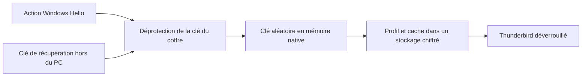

# Windows Hello et chiffrement du profil

État : prototype expérimental. Base initiale : dépôt officiel
`thunderbird/thunderbird-desktop`, branche `main`, révision
`ada7ac0ab6ee12982315d628bb0c6f55b19b0096`.

Le fork ajoute un verrou Windows Hello avant le démarrage du profil et un
prototype natif de chiffrement authentifié. **Il ne chiffre pas encore les mails
du profil Thunderbird et ne constitue pas une version prête à installer.**

## Fonctionnement du verrou

Sur une compilation Windows de ce fork, le processus principal doit réussir une
opération privée avec une clé propre à l'application dans le fournisseur
Microsoft Passport. Windows gère l'empreinte, le visage ou le PIN Hello ;
Thunderbird ne reçoit aucune de ces données. Le choix de la méthode appartient à
Windows, ce n'est pas un mode « empreinte uniquement ».

La vérification a lieu dans `mail/app/nsMailApp.cpp`, après l'installation de la
liste de blocage des DLL et avant `InitXPCOMGlue`. Le profil, les gestionnaires de
ligne de commande et la fenêtre de messagerie ne sont donc pas initialisés par
ce processus avant son authentification. Les processus enfants normaux suivent
leur démarrage existant sans nouvelle demande Hello.

Une clé RSA de signature de 2048 bits, dont la partie privée est non exportable
et distincte des futures clés de chiffrement, signe un défi aléatoire de 32
octets. La clé publique est exportée pour vérifier la signature avec BCrypt :
le fournisseur Passport n'implémente pas lui-même cette vérification sur toutes
les versions de Windows. Une nouvelle action Hello est exigée à chaque
lancement principal ; un refus, une annulation, une politique inattendue ou une
API indisponible empêche le démarrage. Il n'existe aucun réglage de profil ni
variable d'environnement qui désactive le verrou.

La clé de démarrage peut être recréée si elle manque, car aucune donnée n'est
chiffrée avec elle. Cette règle serait dangereuse pour une clé de coffre : une
clé de coffre manquante devra déclencher la récupération, sans remplacement
automatique. Une signature Hello, même valide, ne doit jamais servir de clé AES.

### Limites à conserver visibles

- Le verrou est une protection de l'accès par cette application. Un autre
  programme peut encore lire le profil actuellement en clair.
- Le reverrouillage d'une instance ouverte après inactivité, mise en veille ou
  verrouillage Windows n'est pas implémenté dans cette première étape.
- Les propriétés Passport `NgcCacheType` et `PinCacheIsGestureRequired` ne font
  pas partie du contrat public documenté de CNG. Elles sont isolées dans le
  backend expérimental. Leur absence provoque un refus d'ouverture ; aucune
  substitution par DPAPI ou par le fournisseur logiciel n'est autorisée.
- Le backend n'effectue pas d'attestation matérielle et ne promet donc pas que
  toutes les configurations Hello utilisent un TPM. La présence de Hello ne
  suffit pas à prouver cette propriété.
- Les tests simulés de la frontière Windows vérifient les chemins de refus. Ils
  ne prouvent pas à eux seuls que Windows impose effectivement un nouveau geste
  sur chaque matériel. Le test manuel décrit plus bas reste nécessaire.

## Architecture proposée pour chiffrer les mails

Le périmètre retenu est le **profil complet et son répertoire de cache local**.
Le mot de passe principal de Thunderbird protège les identifiants enregistrés,
pas l'ensemble des messages et des métadonnées ; voir
[la documentation Thunderbird](https://support.mozilla.org/en-US/kb/protect-your-thunderbird-passwords-primary-password).

Un simple `UserConsentVerifier` ne protège aucune clé de chiffrement par
lui-même. Microsoft explique cette distinction dans
[sa présentation de cette API](https://devblogs.microsoft.com/oldnewthing/20240924-00/?p=110308).
De même, cacher une clé DPAPI derrière un écran Hello laisse un chemin de
déchiffrement accessible sans ce geste. Il faut une opération cryptographique
qui rende effectivement la clé du coffre disponible après authentification.



### Clés et récupération

1. Créer une clé maîtresse aléatoire de 256 bits par coffre. Le PIN et la
   biométrie ne sont jamais utilisés comme matière de dérivation.
2. Stocker uniquement une enveloppe chiffrée de cette clé. Étudier et tester
   l'enveloppement par une clé Passport de déchiffrement avec geste obligatoire
   et RSA-OAEP, en vérifiant les capacités réelles du fournisseur. Une clé de
   signature `KeyCredential` n'offre pas automatiquement cette opération.
3. Sur les systèmes compatibles, évaluer également WebAuthn PRF avec vérification
   utilisateur obligatoire, puis dérivation d'une clé d'enveloppement avec HKDF.
   Détecter la prise en charge effective : une API Windows présente ne garantit
   pas que l'authentificateur Hello supporte PRF. Ne pas activer un mode réduit
   silencieusement sur les systèmes plus anciens.
4. Prévoir une seconde enveloppe protégée par une clé de récupération aléatoire
   de 256 bits. L'exporter hors du PC et vérifier sa restauration avant migration.
   Si une phrase choisie par l'utilisateur est proposée, utiliser un KDF adapté
   comme Argon2id avec sel et paramètres versionnés.
5. Lier les enveloppes au coffre, à la version et au type de protection ; ne
   jamais journaliser ni enregistrer la clé déprotégée. Faire tourner les
   enveloppes lors d'un changement de PC ou d'enrôlement Hello, sans rechiffrer
   inutilement tous les messages.

Le déchiffrement OAEP réellement conditionné à Hello, sa résistance au cache du
geste et la récupération après réinitialisation doivent être prouvés sur la
matrice de machines cibles avant tout branchement aux données de l'utilisateur.
Il n'y a pas encore de stockage ou de déprotection de clé maîtresse dans ce fork.

### Stockage et cycle de vie

L'option à prototyper ensuite est un système de fichiers chiffré exposant le
profil seulement pendant une session déverrouillée. Il permet de couvrir les
mails mbox/maildir, les bases SQLite et leurs WAL/journaux, les index `.msf`, la
recherche globale, les contacts, calendriers, brouillons, pièces jointes et
caches. Le moteur et son intégration restent à sélectionner et auditer ; le
format de blob ci-dessous n'est pas un système de fichiers.

Une intégration limitée à `nsIMsgPluggableStore` ne couvre pas les autres bases,
et le chiffrement SQLite seul ne couvre pas les mbox/maildir. Éviter un
déchiffrement intégral du profil dans un dossier temporaire en clair.

Le futur stockage doit gérer accès aléatoire, écritures concurrentes, renommages
atomiques, `fsync`, compactage, intégrité des blocs, génération des nonces et
reprise après coupure. Chiffrer aussi les noms et métadonnées sensibles lorsque
le moteur le permet. Les tailles et la chronologie peuvent rester observables ;
un chiffrement authentifié seul ne détecte pas le rejeu d'une ancienne copie
valide sans état de confiance supplémentaire.

À l'ouverture : déprotéger la clé, ouvrir le stockage, puis lancer le profil.
À la fermeture ou au verrouillage : empêcher les nouveaux accès, terminer les
écritures, fermer le profil et les processus ayant des fichiers ouverts, retirer
l'accès au stockage, puis effacer les clés. Un stockage encore accessible ne
doit jamais être présenté comme verrouillé. Le premier mode sûr pourra quitter
Thunderbird proprement pour verrouiller, avant de proposer un verrouillage sans
redémarrage. Gérer les brouillons non enregistrés avant cette fermeture.

Déplacer `ProfD` et `ProfLD` dans ce périmètre. Identifier les magasins de mails
configurés hors profil et les migrer ou refuser l'activation tant qu'ils restent
exposés. Gérer explicitement les pièces jointes ouvertes dans des applications
externes, l'indexation Windows, les aperçus, notifications, journaux et rapports
de plantage. Les exports volontaires restent une sortie de données à expliquer.

La protection vise la lecture de fichiers au repos et un coffre fermé. Elle ne
garantit pas le secret face à un administrateur, un logiciel malveillant dans la
session déverrouillée ou une capture de mémoire. Le chiffrement du disque reste
complémentaire pour le fichier d'échange, l'hibernation et les traces externes.
Les copies conservées chez le fournisseur de messagerie ne sont pas modifiées.

### Migration

Migrer Thunderbird fermé vers un nouveau coffre, sans transformation destructive
en place : copie, contrôle d'intégrité, test de récupération et bascule atomique.
Garder la source jusqu'à validation. Traiter séparément les sauvegardes, les
anciennes versions et les copies synchronisées dans le cloud. Supprimer un
fichier en clair ne prouve pas son effacement physique, notamment sur SSD.

## Prototype AES-256-GCM

`mail/app/hello/EncryptedBlob.*` implémente des objets en mémoire bornés à 64 Mio
avec Windows CNG : clé de 32 octets, nonce aléatoire de 12 octets, tag de 16
octets. En-tête, longueur et contexte externe obligatoire sont authentifiés.
Le contexte devra contenir l'identité du coffre, de l'objet et sa génération.
Les clés et buffers de texte clair possédés par ces classes sont effacés à la
destruction ; un déchiffrement échoué ne restitue aucun texte clair.

| Octets | Contenu |
| --- | --- |
| 0–7 | `TBVAULT` suivi de la version binaire `1` |
| 8–19 | Nonce GCM |
| 20–27 | Longueur du texte clair, entier 64 bits little-endian |
| 28–43 | Tag GCM |
| 44–fin | Texte chiffré |

Les données authentifiées supplémentaires sont l'en-tête de 28 octets, la
longueur du contexte sur 4 octets little-endian, puis le contexte. Le format
rejette versions inconnues, troncatures, longueurs incohérentes et ajouts.

Ce module ne lit ni n'écrit de mails. Il n'est pas relié au stockage Thunderbird,
ne sérialise pas de clé, n'implémente ni récupération ni montage de coffre.
Un stockage de production devra fixer les budgets de nonces et de volume par
clé, la dérivation des sous-clés et la gestion des générations. L'effacement
des buffers possédés ne constitue pas une garantie concernant toutes les copies
en mémoire, la pagination ou les applications externes.

## Compilation et validation

Les modules natifs se compilent indépendamment de Gecko. Depuis un Developer
PowerShell Visual Studio :

```powershell
.\tools\windows-hello\run-native-tests.ps1
```

Ou avec un Zig installé séparément :

```powershell
.\tools\windows-hello\run-native-tests.ps1 -ZigPath C:\outils\zig\zig.exe
```

Les tests vérifient les chemins de refus du verrou avec une frontière Windows
simulée, puis les opérations AES-GCM avec le vrai fournisseur Windows CNG.
Ils n'affichent aucune demande Hello et n'enrôlent aucune clé. Le programme
`HelloProbe.exe` est compilé séparément pour tester le vrai backend : le lancer
avec `--authenticate`, puis effectuer soi-même la vérification Windows.

Validation effectuée le 16 novembre 2026 sur Windows 10 avec Zig 0.15.2 :

- Compilation C++17 des deux tests et du backend réel, avertissements traités
  comme erreurs ; 28 scénarios du verrou réussis.
- AES-GCM réel : fixture indépendante produite par Node/OpenSSL, texte binaire
  ou vide, nonces distincts, aliasing, mauvaise clé ou contexte, modification de
  chaque octet, toutes les troncatures, bornes et effacement des buffers.
- Test interactif du backend Hello réussi après validation manuelle ; annulation
  de l'enrôlement correctement refusée.
- Après succès, vérification matérielle supplémentaire en mode privé silencieux
  avec geste obligatoire : refus `NTE_SILENT_CONTEXT` (`0x80090022`), sans afficher
  une nouvelle demande. Cela contrôle le chemin de cache sur cette configuration.
- Formatage avec la configuration clang-format de Gecko, syntaxe des fichiers de
  configuration vérifiée et contrôle `git diff --check` réussi.

La compilation complète de Thunderbird et `mach commlint` n'ont pas été exécutés
dans cet espace : le dépôt Gecko parent et sa chaîne de compilation ne sont pas
installés. La validation native ne remplace pas un lancement de Thunderbird.

Pour compiler Thunderbird complet, ce dépôt doit être le sous-dossier `comm/`
du dépôt Firefox compatible. Suivre
[le guide officiel](https://developer.thunderbird.net/thunderbird-development/building-thunderbird),
avec `ac_add_options --enable-project=comm/mail`, puis `./mach build` dans le
parent. Le verrou est activé par défaut sous Windows. Les compilations de tests
sans matériel Hello peuvent utiliser `ac_add_options --disable-windows-hello-lock` ;
ce choix est fixé à la compilation, pas dans le profil. Le lint du fork utilise
`../mach commlint` depuis `comm/`.

Avant une distribution : compiler et lancer Thunderbird complet avec un profil
de test séparé ; tester succès, annulation, absence de Hello, réenrôlement,
redémarrage, fenêtres secondaires, `mailto:`, profil alternatif, mode dépannage,
processus enfants, lancement concurrent et session distante. Puis tester la
migration, les crashs d'écriture et les fuites hors coffre avant de qualifier le
stockage de chiffré.

## Références techniques

- [NCryptSignHash](https://learn.microsoft.com/en-us/windows/win32/api/ncrypt/nf-ncrypt-ncryptsignhash)
  et [NCryptDecrypt](https://learn.microsoft.com/en-us/windows/win32/api/ncrypt/nf-ncrypt-ncryptdecrypt).
- [Fournisseurs et propriétés CNG](https://learn.microsoft.com/en-us/windows/win32/seccng/key-storage-property-identifiers).
- [Windows Hello pour les applications](https://learn.microsoft.com/en-us/windows/apps/develop/security/windows-hello).
- [Options WebAuthn GetAssertion et PRF](https://learn.microsoft.com/en-us/windows/win32/api/webauthn/ns-webauthn-webauthn_authenticator_get_assertion_options)
  et [extension PRF du W3C](https://www.w3.org/TR/webauthn/#prf-extension).
